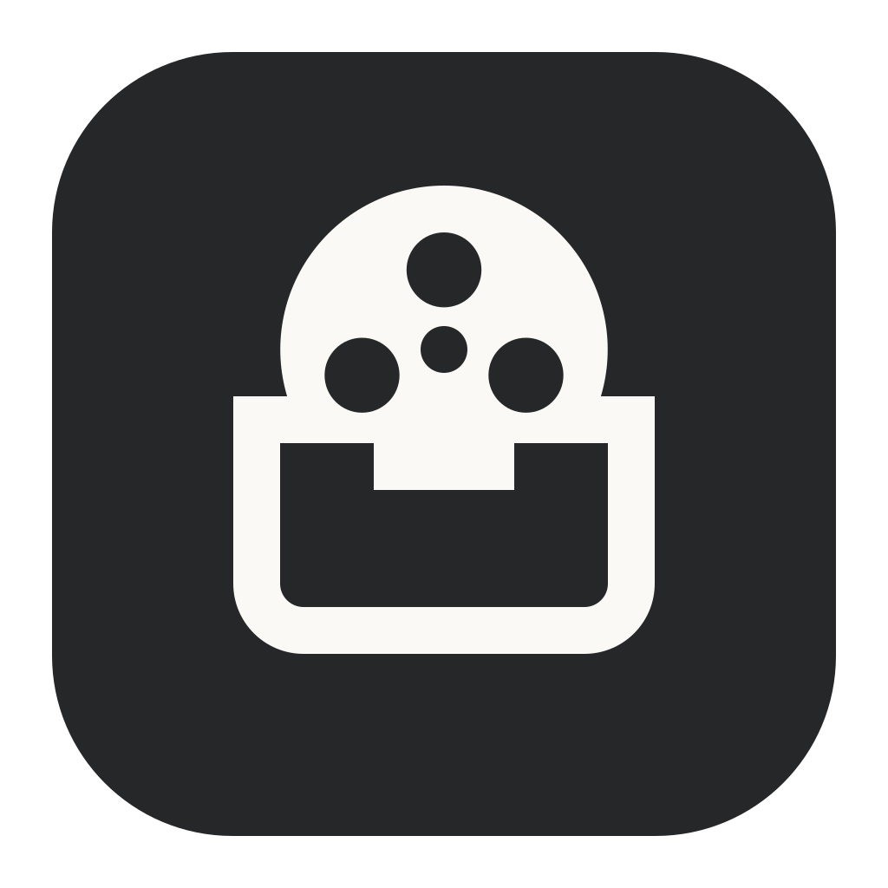
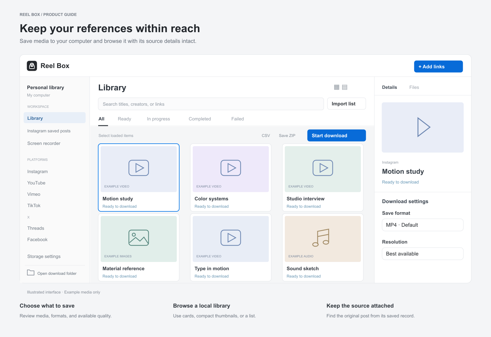
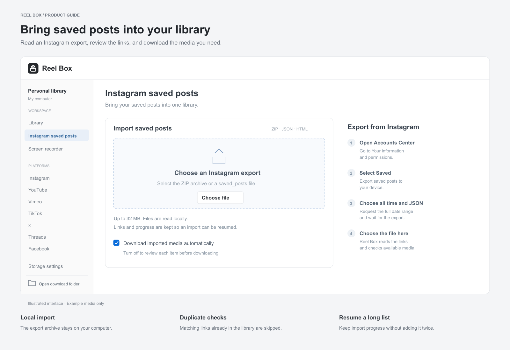
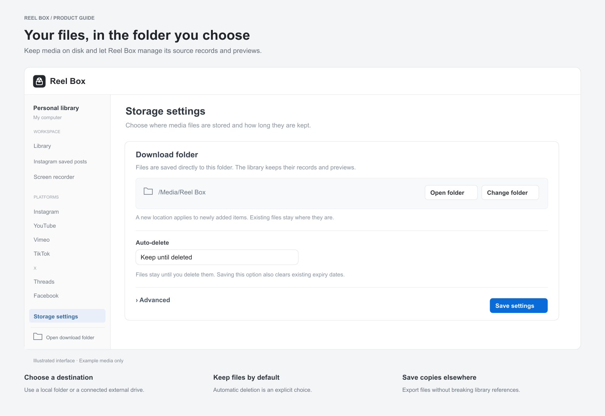

<h1 align="center">Reel Box</h1>

A local library for videos, images, and audio.

<a href="https://github.com/ryonghwon/reel-box/releases">Download</a> · <a href="docs/USAGE.md">User guide</a> · <a href="docs/CONFIGURATION.md">Storage and settings</a> · <a href="docs/BUILD.md">Build</a>

Reel Box saves media from supported platforms into folders on your computer. Add several links at once, or import an Instagram saved-posts export, then review the available media and choose what to download. Search, previews, and source links keep the resulting files organized in one library.

Videos are saved as MP4 by default, with a choice of available resolutions. Images from the same post stay together; videos remain individually accessible. Files are kept until you delete them unless you explicitly enable automatic deletion.

## What you can do

| Workflow | How it works |
| --- | --- |
| Collect links | Paste up to 100 URLs at a time. Reel Box checks metadata, identifies media, and skips matching existing links. |
| Import saved posts | Read Instagram export ZIP, JSON, or HTML files. Pause and resume an import without starting the list again. |
| Choose the output | Use MP4, keep the original video format, or extract audio. Choose from the resolutions actually available for a video. |
| Organize media | Switch between cards, compact thumbnails, and a list. Search titles, creators, and source links; filter by platform or task status. |
| Recover failed items | Read the error for each item, retry eligible failures, or open Instagram items in the app’s signed-in window. |
| Use files elsewhere | Open the download folder, save individual copies, or export a ZIP with a CSV manifest. |
| Record a screen | Capture a source you select, review it, and add an MP4 copy to the library. |

Downloads run through a local queue. The desktop app includes its own runtime, so it does not require Docker, a separately opened browser, or an AI API key. Reel Box does not analyze your media.

The app retains its Korean interface. This repository’s documentation and illustrated guides use English.

## Install

Choose a package from [Releases](https://github.com/ryonghwon/reel-box/releases).

| System | Package |
| --- | --- |
| Mac with Apple Silicon | `Reel-Box-<version>-macOS-arm64.zip` |
| Windows x64 | `Reel-Box-<version>-Windows-x64-Setup.exe` |

Extract the Mac archive and move **Reel Box.app** to Applications. On Windows, run the installer and choose the installation folder. Open the app, then use **Storage settings** to select a download location before importing a large list.

Mac archives are ad-hoc signed and checked for integrity, but are not notarized by Apple. Windows packages are unsigned. Your operating system may require approval before first launch. Release assets include a checksum manifest. See the [build guide](docs/BUILD.md) for source setup and packaging details.

## Platform coverage

| Platform | Accepted content |
| --- | --- |
| Instagram | Reels, video and photo posts, carousels, saved-post export files |
| YouTube | Videos, Shorts, playlists, channels, audio extraction |
| Vimeo | Individual videos |
| TikTok | Video and photo posts |
| X | Posts with video or image attachments |
| Threads | Posts with media attachments |
| Facebook | Video and photo posts |

Coverage describes accepted inputs, not a guarantee that every post can be retrieved. Media availability depends on the platform response, attachment type, and access requirements. Reel Box reports the reason when an item cannot be downloaded.

Instagram sign-in uses the app’s dedicated window. Other browser sessions are separate, and other platforms use accessible public links. Save content you have permission to use; the app does not bypass access restrictions or DRM.

## Start with a few links

1. Select **Add links** and paste one URL per line.
2. Choose **Detect media type** or **Audio only**, then select **Check links**.
3. Select a ready item to review its preview, format, and resolution.
4. Select **Start download**. Finished files appear in the item’s **Files** tab and in your download folder.

For a saved-post archive, open **Instagram saved posts** instead. The [user guide](docs/USAGE.md) explains import progress, image groups, signed-in retries, and exports.

## Documentation

| Guide | Contents |
| --- | --- |
| [User guide](docs/USAGE.md) | Links, saved-post imports, sign-in, downloads, exports, and recording |
| [Storage and settings](docs/CONFIGURATION.md) | Download locations, retention, filenames, runtime settings, and backups |
| [Troubleshooting](docs/TROUBLESHOOTING.md) | Connection errors, restricted posts, failed tasks, and missing files |
| [Build](docs/BUILD.md) | Desktop packaging, Docker setup, and validation commands |
| [Architecture](docs/ARCHITECTURE.md) | Processes, queue state, media grouping, and authentication |

## Interface guides

These illustrations use example media and contain no personal library data.

| Import saved posts | Storage settings |
| --- | --- |
|  |  |

## License

Application source is available under the [MIT License](LICENSE). Platform trademarks and bundled dependencies remain subject to their respective owners’ rights and licenses. See [Third-party notices](desktop/THIRD-PARTY-NOTICES.txt) for runtime notices.
