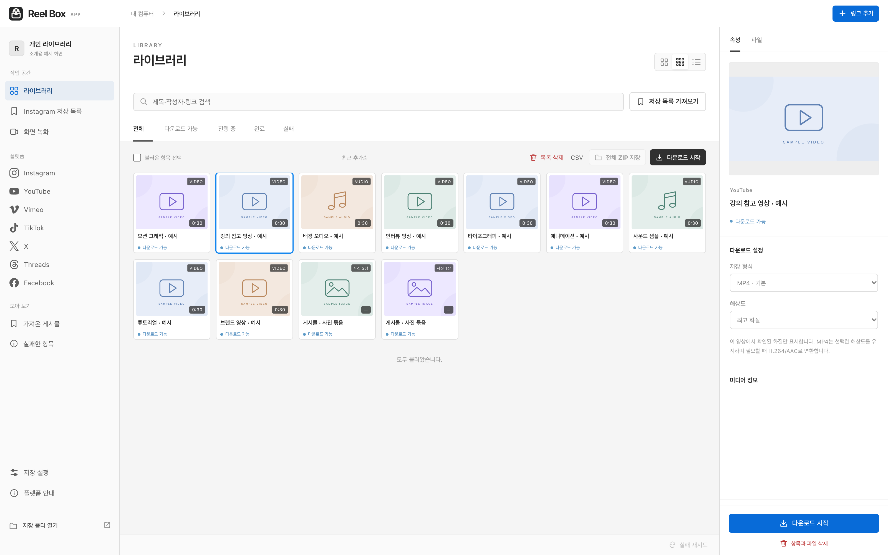
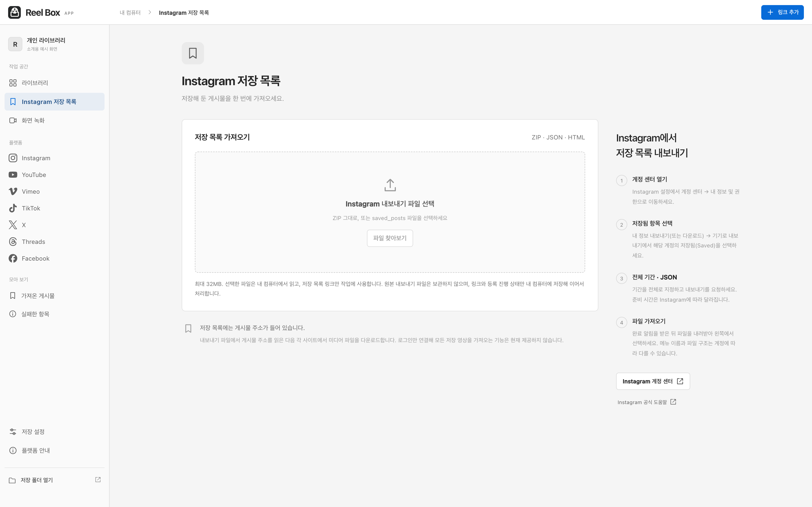
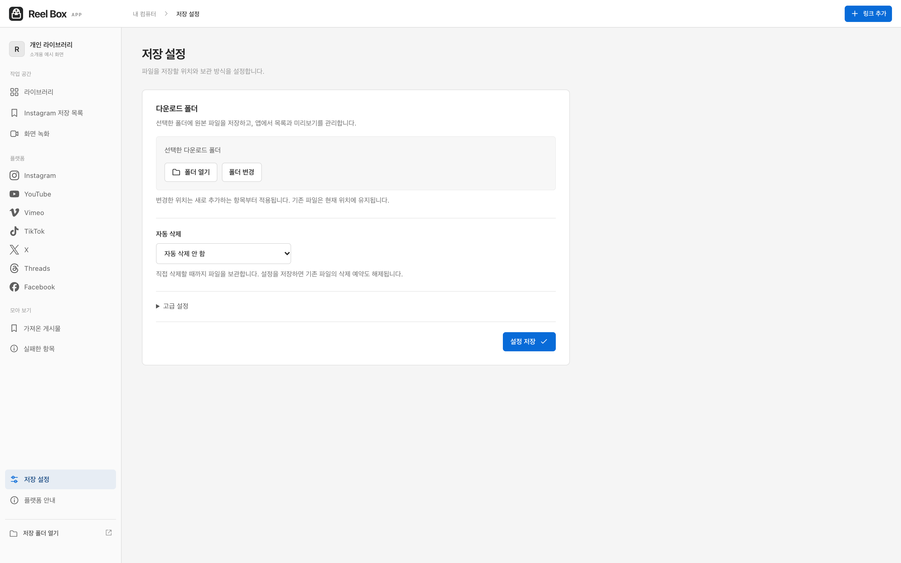

# Reel Box

Reel Box는 영상·이미지·오디오를 내려받아 로컬 폴더에 보관하는 데스크톱 미디어 라이브러리입니다. 여러 링크를 한 번에 추가하거나 Instagram 저장 목록을 가져와 다운로드할 수 있습니다.



## 기능

- URL 일괄 등록과 중복 링크 확인
- Instagram 저장 목록 가져오기: ZIP, JSON, HTML
- MP4 저장, 해상도 선택, 오디오 추출
- 게시물별 사진 묶음과 개별 영상 관리
- 검색, 상태 필터, 카드·작은 썸네일·목록 보기
- 병렬 다운로드, 실패 재시도, Instagram 로그인 창
- 개별 파일, ZIP, CSV 내보내기
- 저장 폴더, 파일명 규칙, 자동 삭제 설정
- 화면·창 녹화와 MP4 변환

## 사용 안내

| 문서 | 내용 |
| --- | --- |
| [사용 가이드](docs/USAGE.md) | 링크 추가, 저장 목록, 로그인, 다운로드, 파일 관리 |
| [설정](docs/CONFIGURATION.md) | 저장 위치, 보관 정책, 파일명, 실행 환경 |
| [설치와 빌드](docs/BUILD.md) | Docker 실행, 데스크톱 패키징, 검사 명령 |
| [문제 해결](docs/TROUBLESHOOTING.md) | 연결, 인증, 다운로드, 저장 파일 오류 |
| [구조](docs/ARCHITECTURE.md) | 앱 구성, 대기열, 데이터 흐름 |

## 플랫폼

| 플랫폼 | 입력 |
| --- | --- |
| Instagram | Reels, 영상·사진 게시물, 저장 목록 |
| YouTube | 영상, Shorts, 재생목록, 채널 |
| Vimeo | 개별 영상 |
| TikTok | 영상, 사진 게시물 |
| X | 영상·사진 첨부 게시물 |
| Threads | 미디어 첨부 게시물 |
| Facebook | 영상·사진 첨부 게시물 |

다운로드할 미디어와 화질은 해당 링크에서 제공되는 항목을 기준으로 표시합니다. 로그인이 필요한 Instagram 게시물은 앱의 전용 창에서 열어 저장합니다. 다른 플랫폼은 공개 링크를 사용합니다. 이용 권한이 있는 콘텐츠를 저장하세요.

## 실행

데스크톱 패키지는 앱 창, 로컬 서버, 작업 대기열을 함께 실행합니다. Docker 실행은 브라우저에서 사용하는 별도 구성입니다.

소스에서 Docker로 실행하려면 저장소 루트에서 다음 명령을 실행합니다.

```sh
sh scripts/setup.sh
docker compose up --build -d
```

브라우저에서 [localhost:3000](http://localhost:3000)을 엽니다. Windows에서는 `Start-Reelbox.cmd`를 실행합니다. 세부 요구 사항과 설치 파일 생성 방법은 [설치와 빌드](docs/BUILD.md)에 있습니다.

## 화면

<details>
<summary>저장 목록 가져오기</summary>



</details>

<details>
<summary>저장 설정</summary>



</details>

화면에는 예시 데이터를 사용했습니다.

## 라이선스

애플리케이션 코드는 [MIT License](LICENSE)를 따릅니다. 플랫폼 상표와 종속성에는 각 소유자의 권리 및 라이선스가 적용됩니다. 포함되는 런타임의 고지는 [THIRD-PARTY-NOTICES.txt](desktop/THIRD-PARTY-NOTICES.txt)에 있습니다.
